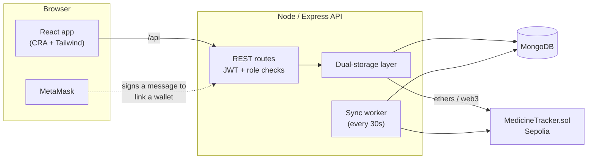
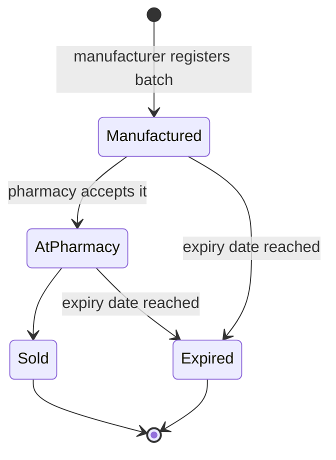
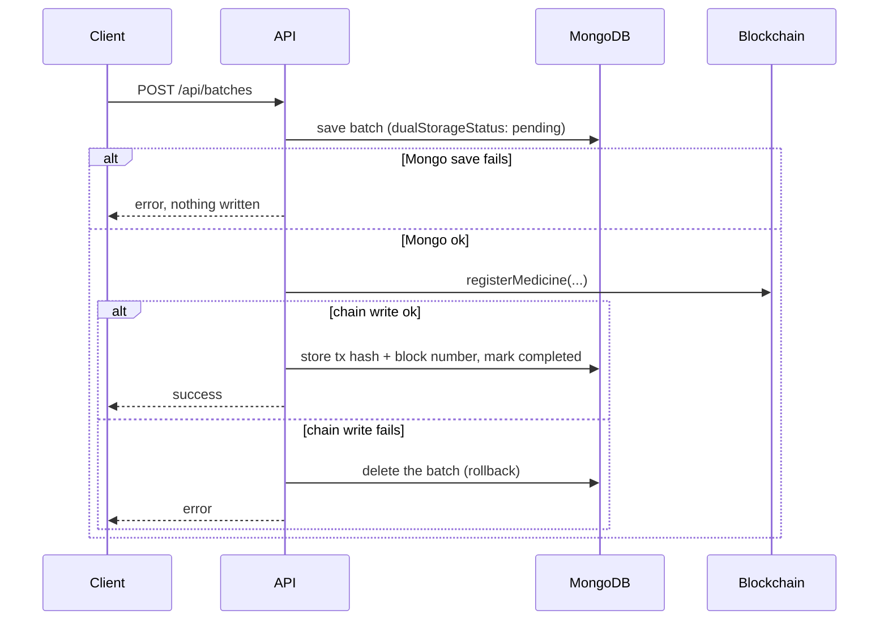

<p align="center">
  
</p>

<h1 align="center">Medicheck</h1>

<p align="center">
  Blockchain-backed medicine batch tracking and verification.<br>
  Final year project by <a href="https://github.com/Ahmer-kun">Ahmer-kun</a>.
</p>

---

A web app for tracking medicine batches from manufacturer to pharmacy, and letting anyone check a batch number to see whether it's real, where it is, and whether it has expired.

Every batch is written to two places: MongoDB, for fast queries and the dashboards, and an Ethereum smart contract (Sepolia testnet), so the record of who registered it and who received it can't be quietly edited afterwards.

<!-- Screenshots: add 2-3 real ones (verify page, manufacturer dashboard, batch history) in docs/screenshots/ and uncomment:

-->

## The problem

Counterfeit and expired medicine tends to get through because nobody downstream can cheaply check what an upstream party claims. A pharmacist has to take the manufacturer's word for it, and a patient has to take the pharmacist's. Medicheck puts the batch record somewhere none of them can rewrite on their own, and gives everyone a public page to look it up.

## How it fits together



Two things worth knowing about this layout:

- **The browser never sends blockchain transactions.** The backend holds a single signing key (`DEPLOYER_PRIVATE_KEY`) and submits every transaction itself. MetaMask is only used to prove that a company controls a wallet address, which is then used as the recipient when a batch is handed over.
- **MongoDB is the working copy, the chain is the audit trail.** Reads for dashboards come from Mongo. The public verify page checks both.

## What a batch goes through



1. A **manufacturer** registers a batch (one at a time, or by importing an Excel sheet). It's stored in Mongo and registered on-chain.
2. A **pharmacy** accepts the batch and says how many units it received. Two transactions follow: `transferMedicine` (ownership moves to the pharmacy's linked wallet) and `updateMedicine` (status and quantity).
3. Anyone can open `/verify`, enter a batch number or scan the QR code, and see the batch details, its current holder, and whether it's expired.

A batch counts as expired on its expiry date, not the day after.

## The part I spent the most time on: keeping two stores in sync

Writing to a database and a blockchain isn't atomic. Either can fail on its own, and a blockchain write can take seconds or fail on gas. The approach:



MongoDB goes first because it's cheap to undo. If the chain write fails, the Mongo record is deleted, so you never end up with a batch in the dashboard that the chain doesn't know about. This lives in `utils/dualStorage.js` and `controllers/batchController.js`.

For writes that can't complete right away, there's a background worker (`services/syncWorker.js`) that runs every 30 seconds:

- **Mongo to chain:** items in `BlockchainSyncQueue` are retried up to 5 times with exponential backoff (5s doubling, capped at 5 minutes).
- **Chain to Mongo:** items in `TemporaryBatch` that made it on-chain but not into Mongo get copied across.

## The smart contract

`medicheck-backend/contracts/MedicineTracker.sol`, Solidity 0.8.19.

Each batch is a struct keyed by batch number: name, formulation, manufacture and expiry dates, quantity, manufacturer, pharmacy, packaging, status, current owner, and verification fields. Every ownership change is appended to a per-batch transfer history.

| Function | What it does |
| --- | --- |
| `registerMedicine` | Creates a batch. Reverts if the batch number already exists. The caller becomes the owner and a "Manufactured" entry is added to the history. |
| `transferMedicine` | Current owner hands the batch to another address, with a type and metadata string. Appended to the history. |
| `updateMedicine` | Current owner changes status, pharmacy or quantity. |
| `verifyMedicine` | Marks a batch as verified, recording who and when. One-time. |
| `getMedicine`, `getMedicineHistory`, `getMedicineVerificationStatus`, `verifyMedicineExistence`, `getAllBatchNumbers` | Read-only lookups. |

Events are emitted for registration, update, transfer and verification.

## Who can do what

| Role | Can |
| --- | --- |
| `manufacturer` | Register and import batches, manage their company profiles, link a wallet |
| `pharmacy` | Accept batches, manage stock, link a wallet, check batches against the chain |
| `viewer` | Look up batches, open support tickets |
| `analytics` | Read the analytics dashboard |
| `admin` | Everything above, plus user management (create, deactivate, reset password), system logs, recalls, support tickets |

Auth is a JWT in the `Authorization` header. When it expires, the API answers with `tokenExpired: true` and the frontend calls `/api/auth/refresh-token` instead of logging the user out. Deactivated accounts are rejected on every request, not just at login.

## Running it locally

You'll need Node, MongoDB, and the MetaMask extension. The frontend's `package.json` asks for Node 24 or newer.

### 1. Backend

```bash
git clone https://github.com/Ahmer-kun/medicheck.git
cd medicheck/medicheck-backend
npm install
```

Create `medicheck-backend/.env`:

```env
PORT=5000
NODE_ENV=development
MONGODB_URI=mongodb://localhost:27017
JWT_SECRET=pick-something-long-and-random
JWT_EXPIRES_IN=7d

# Local chain (see step 2). For Sepolia, use your Infura/Alchemy URL instead.
BLOCKCHAIN_NETWORK=http://127.0.0.1:8545
DEPLOYER_PRIVATE_KEY=<private key of the account that will sign transactions>
CONTRACT_ADDRESS=        # filled in automatically by the deploy script

# Optional
APP_URL=http://localhost:3000
SMTP_HOST=
SMTP_USER=
SMTP_PASS=
FROM_NAME=Medicheck
FROM_EMAIL=
ETHERSCAN_API_KEY=       # only for contract verification
```

The app connects to a database named `medicheck` on that Mongo instance.

### 2. A local chain and the contract

In one terminal:

```bash
npx hardhat node
```

It prints a list of funded test accounts. Put the first account's private key in `DEPLOYER_PRIVATE_KEY`. In a second terminal:

```bash
npm run deploy-local
```

This deploys `MedicineTracker`, writes the address to `contract-info.json`, and updates `CONTRACT_ADDRESS` in your `.env`.

### 3. Start the API and seed users

```bash
npm run dev
curl -X POST http://localhost:5000/api/auth/initialize-users
```

The second command creates the default accounts. Change their passwords before putting this anywhere other people can reach it.

### 4. Frontend

```bash
cd ../medicheck-frontend
npm install
echo "REACT_APP_API_URL=http://localhost:5000/api" > .env
npm start
```

Open `http://localhost:3000`. If you skip the `.env` file, the frontend falls back to the hosted Railway URL hard-coded in `src/utils/api.js`.

### Using Sepolia instead

Set `BLOCKCHAIN_NETWORK` to a Sepolia RPC URL, fund the signer with test ETH (`npm run get-eth` prints faucet links), then `npm run deploy-sepolia`. The network is detected from the URL, so a Sepolia endpoint switches the service into "real blockchain" mode with transaction monitoring.

## API

Base path is `/api`. Anything not marked public needs a bearer token.

| Method | Path | Notes |
| --- | --- | --- |
| POST | `/auth/login` | Returns a JWT |
| POST | `/auth/refresh-token` | |
| GET | `/batches/verify/:batchNo` | **Public.** Checks Mongo, then the chain |
| POST | `/batches` | Create a batch (dual write) |
| POST | `/batches/import-excel` | Manufacturer or admin |
| PUT | `/batches/accept/:batchNo` | Pharmacy or admin |
| POST | `/pharmacy/accept-batch` | Accept with quantity; records the on-chain transfer |
| GET | `/pharmacy/verify-blockchain/:batchNo` | Compare Mongo against the chain |
| GET | `/blockchain/batch/:batchNo` | Raw on-chain record |
| GET | `/blockchain/status`, `/system/health` | Health and sync status |
| POST | `/metamask/verify-link` | Link a wallet to a company via signed message |
| GET | `/admin/stats`, `/admin/users`, `/admin/logs`, `/admin/recalls` | Admin only |
| POST | `/support/tickets` | |

There are more routes than this (company management, analytics, and a pile of `/debug-*` endpoints I used while building). `server.js` and `routes/` are the source of truth.

## Project layout

```
medicheck-backend/
  contracts/        MedicineTracker.sol and its ABI
  controllers/      request handlers (batch, pharmacy, admin, auth, ...)
  models/           Mongoose schemas (Batch, PharmacyMedicine, BlockchainSyncQueue, ...)
  services/         blockchainService, syncWorker, transactionMonitor, emailService
  utils/            dualStorage, email templates, helpers
  scripts/          deploy, faucet and diagnostic scripts
  server.js

medicheck-frontend/
  src/pages/        one file per screen (Manufacturer, Pharmacy, Verify, Admin, Analytics, ...)
  src/components/   MetaMaskConnector, BlockchainVisualization, ExcelImportModal, ...
  src/hooks/        useAuth, useApi, useMetaMask
  src/utils/api.js  API client with token refresh
```

## Tech

React 19 (Create React App), Tailwind, Recharts, `qrcode.react`, ethers v6 on the frontend. Express 4, Mongoose 7, ethers v6 and web3.js, Joi, Helmet, `express-rate-limit`, Nodemailer on the backend. Hardhat and Solidity 0.8.19 for the contract. Frontend deploys to Vercel, backend to Railway.

## Known limitations

I'd rather list these than have someone find them:

- **The contract trusts its caller.** `registerMedicine` and `verifyMedicine` have no access control, so the security model depends on the backend being the only party that submits transactions. Putting role checks or an allow-list in the contract is the obvious next step.
- **One custodial signing key.** Because the server signs everything, a leaked `DEPLOYER_PRIVATE_KEY` is a full compromise of the on-chain record. A production version would sign from each company's own wallet.
- **Verification falls back to the database.** If the chain lookup fails, `/batches/verify` still answers from MongoDB and reports the batch as authentic if it isn't expired. The message text changes ("found but not blockchain verified"), but the `authentic` flag doesn't.
- **Testnet only.** It's deployed on Sepolia, so nothing here has real-world standing.
- **Tests are integration scripts.** `npm test` runs `test-endpoints.js` against a running server. There's no unit test suite for the controllers or the contract yet.
- **`server.js` is large**, and still contains debug routes and commented-out old versions. It needs splitting up and cleaning before any real deployment.

## License

MIT. See [LICENSE](LICENSE).